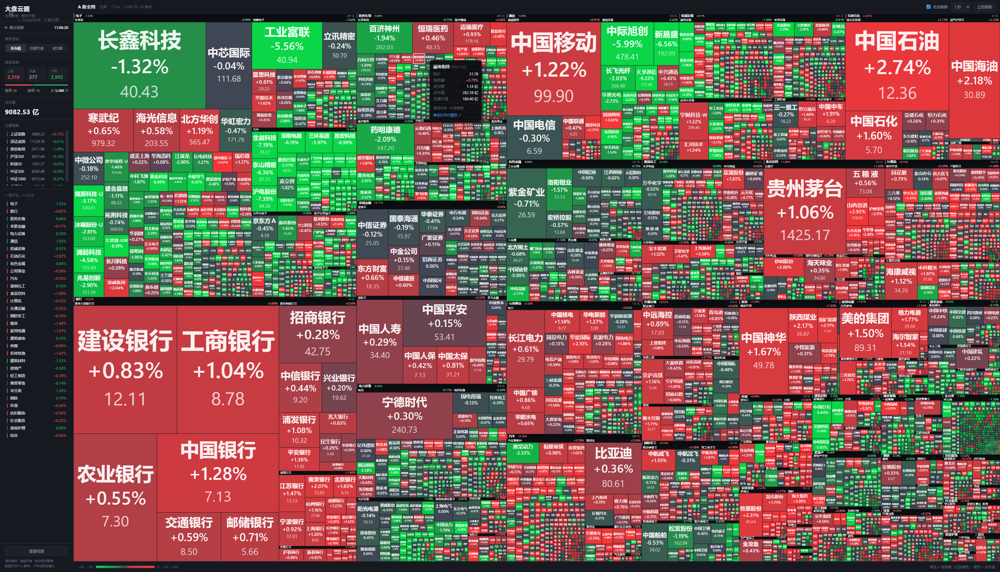

# 大盘云图 · DaPanYunTu

> 全市场 5500+ 只个股的**两个视角**。
> **大盘云图**（`/`）按「一级行业 → 二级行业」铺成 treemap，看**结构**；
> **行业情况**（`/sector`）是一张板块强度榜（RS / 宽度 / 资金占比），看**强弱**。
> 两者共用同一个后端和同一份行情快照，数据每 5 秒自动刷新。

## 🚀 在线体验（点开就能用，不用装任何东西）

**https://steelocean2024.github.io/DaPanYunTu/**

纯静态托管在 GitHub Pages 上，**没有服务器**——浏览器直接连腾讯行情接口取数并自行计算，每 10 秒刷新。

| 页面 | 地址 |
|---|---|
| 大盘云图（结构） | https://steelocean2024.github.io/DaPanYunTu/heatmap/ |
| 行业情况（强弱） | https://steelocean2024.github.io/DaPanYunTu/sector/ |

## 💻 本地运行（5 秒刷新 + 板块快照落盘）

```bash
python scripts/build_industry_map.py    # 首次：建行业映射缓存，约 50 秒，7 天有效
python scripts/heatmap_server.py        # 起服务
```

→ 云图 `http://127.0.0.1:8770/` · 行业情况 `http://127.0.0.1:8770/sector`

两条链路的差别：本地走 Python 后端（能落盘、能扩展、5 秒一轮）；线上走浏览器直连（零成本、10 秒一轮）。
**页面是同一套**——后端优先，拿不到就自动切浏览器直连。

> 📚 **想从头读懂这个项目？** 看 [`learning/`](learning/)：
> 项目全貌 · 架构与数据流 · 指标口径 · 代码地图 · 踩坑清单 · 开发部署手册 · 带真实时间戳的项目日志。



---

## 一、它解决什么问题

看盘时最费劲的一件事是「今天市场到底是什么结构」：

指数只告诉你加权后的一个数字，涨跌家数只告诉你宽度，
但**钱在往哪个板块走、哪个权重股在拖指数**——这些从数字上看不出来。

云图把三维信息压到一张图上：

| 视觉通道 | 编码的信息 |
|---|---|
| 面积 | 规模（总市值 / 流通市值 / 成交额，可切换） |
| 颜色 | 涨跌幅（红涨绿跌，两端鲜艳、中间暗） |
| 位置 | 行业归属（一级行业 → 二级行业 → 个股） |

但云图是**截面工具**——它只能回答「今天市场长什么样」，回答不了
「这个板块是真动还是假动、跑到哪一步了」。所以配了第二个视图 `/sector`（板块强度榜），
详见 [`docs/07_行业情况.md`](docs/07_行业情况.md)。

---

## 二、数据从哪来

**刻意避开了东方财富。** 它的 `push2` 一次就能返回全市场，但按 IP 限流，
触发后 5~40 分钟不可用。云图要 5 秒刷一轮，用东财必死。实测东财接口现在仍在限流冷却期。

| 环节 | 数据源 | 实测 | 更新频率 |
|---|---|---|---|
| 全市场行情 | 腾讯批量 `qt.gtimg.cn` | **5580 只 / 约 1.1 秒** | 每 5 秒 |
| 市值 / 成交额 | 腾讯字段 `[44][45][37]` | ✓ | 每 5 秒 |
| 行业分类 | 申万研究所（经 akshare） | 一级 31 / 二级 131 | 缓存 **7 天** |
| 成分股 | `index_component_sw` | 0.5 秒 / 行业，共约 50 秒 | 缓存 **7 天** |
| 代码表 | `stock_info_a_code_name` | **5580 只** | 缓存 **7 天** |

腾讯字段单位（**踩过坑，差过好几个数量级**）：

| 字段 | 含义 | 单位 | 换算 |
|---|---|---|---|
| `[36]` | 成交量 | 手 | ×100 → 股 |
| `[37]` | 成交额 | **万元** | ×1e4 → 元 |
| `[44]` | 流通市值 | **亿元** | ×1e8 → 元 |
| `[45]` | 总市值 | **亿元** | ×1e8 → 元 |

---

## 三、架构：慢路径 / 快路径分离

```
        慢路径（几分钟级，缓存 7 天）
        ┌──────────────────────────────────────┐
        │ 申万行业树  31 个一级 / 131 个二级      │
        │ 成分股      index_component_sw        │
        │ 全市场代码表 stock_info_a_code_name    │
        └───────────────┬──────────────────────┘
                        │  runtime/data/industry/*.parquet
                        │  runtime/data/heatmap/*.parquet
                        ▼
        快路径（秒级，后台线程每 5 秒一轮）
        ┌──────────────────────────────────────┐
        │ 腾讯批量行情  5580 只 / 约 1.1 秒       │
        │   ↓ 挂行业                            │
        │ 组装 treemap 树 → 内存里序列化成 bytes │
        └───────────────┬──────────────────────┘
                        │  HTTP /api/heatmap/treemap
                        ▼
                   浏览器（Canvas 渲染）
```

**慢/快分离是「实时」能做成的唯一原因**：行业归属几个月才变一次，拉一次缓存起来；
每轮刷新只补价格和市值。否则每 5 秒拉一次 131 个行业的成分股（50 秒），实时就是空话。

---

## 四、快速开始

```bash
python -m pip install -r requirements.txt

# 第一次：构建行业映射与代码表缓存（约 50 秒，之后 7 天内不用再跑）
python scripts/build_industry_map.py

# 启动服务
python scripts/heatmap_server.py
# 结构视图 http://127.0.0.1:8770/
# 强弱视图 http://127.0.0.1:8770/sector
```

---

## 四之二、部署到 GitHub Pages（无需服务器）

**已部署：https://steelocean2024.github.io/DaPanYunTu/**

线上地址结构（`web/` 就是站点根）：

```
/            落地页（两个入口）
/heatmap/    大盘云图
/sector/     行业情况
/shared/     两个页面共用的前端数据层
/data/       行业映射导出（89 KB）
```

### 为什么静态托管也能实时

腾讯的行情接口不给 CORS 头，但它是「赋值给全局变量的脚本」（`v_sh600000="..."`），
**`<script>` 标签不受同源策略限制**，所以浏览器能直接拿全市场行情。
`web/shared/market.js` 就是干这个的：分批（600/批）× 8 并发，5580 只约 2 秒。

完整链路：加载行业映射 → 批量拉行情 → 按板块聚合成 treemap / 强度榜，全部在浏览器里完成。

### 代价（必须知道）

`web/shared/market.js` 是 `src/heatmap/quotes.py` + `src/analysis/sector.py` + `src/heatmap/treemap.py`
的**第二份实现**。两份逻辑必须同步维护：

| | 权威实现 | 用途 |
|---|---|---|
| Python | `src/` | 本地/服务器：5 秒刷新、可落盘、可扩展 |
| JavaScript | `web/shared/market.js` | 纯静态托管：浏览器直连，10 秒刷新 |

**改动任何一边的口径，另一边要一起改。** 两边已逐项对齐验证过：
全市场汇总（涨跌家数/涨停/成交额）、32 个一级行业的 value 与涨跌幅、
132 个二级行业、5580 只个股——全部零差异。

### 发布

`.github/workflows/pages.yml` 在推送到 `main` 后自动把 `web/` 发布到 Pages。
仓库 **Settings → Pages → Source** 选 **GitHub Actions** 即可。

行业映射变了（申万半年调一次）要重新导出并提交：

```bash
python scripts/export_web_data.py
```


可选参数：

```bash
python scripts/heatmap_server.py --port 8770 --interval 5
python scripts/build_industry_map.py --force     # 忽略 7 天缓存强制重建
```

---

## 五、接口

| 路径 | 说明 |
|---|---|
| `GET /` | 云图页面 |
| `GET /style.css` `/app.js` | 前端静态资源 |
| `GET /api/heatmap/treemap?metric=…` | 云图数据（嵌套树 + 汇总），`metric` ∈ `total_mcap` / `float_mcap` / `amount` |
| `GET /api/heatmap/summary` | 只要汇总 |
| `GET /api/heatmap/status` | 服务状态（刷新次数、耗时、错误） |
| `GET /api/sector/strength` | 板块强度：`{updatedAt, market, l1[], l2[]}`，按 RS 排好序 |

---

## 六、操作

| 操作 | 效果 |
|---|---|
| 滚轮 | 以光标为锚点缩放（**下限就是全图**，缩不出去） |
| 拖拽 | 平移（**画布始终铺满**，不露底色） |
| 悬浮方块 | 显示名称/代码/现价/涨跌幅/成交额/市值/行业路径 |
| **点击个股方块** | 新标签页打开同花顺个股行情页 |
| 点击左侧行业 | 聚焦到该板块 |
| `0` 键 / 重置视图 | 回到全图 |
| 面积指标 | 在总市值 / 流通市值 / 成交额之间切换（**就地重算，不重新拉行情**） |
| 窄屏（≤900px） | 侧栏收成浮层抽屉，画布占满整宽 |

---

## 七、文件结构

```
src/
├── common/
│   ├── paths.py          路径解析（全部从 PROJECT_ROOT 派生，不依赖 cwd）
│   └── logger.py         日志
├── data/
│   └── codes.py          代码规范化：normalize / exchange_of / to_market_code
├── analysis/
│   └── sector.py         板块强度指标（纯函数）+ 快照落盘
└── heatmap/
    ├── industry.py       申万行业树 + 成分股 → 缓存（慢路径）
    ├── universe.py       全市场代码表 → 缓存（慢路径）
    ├── quotes.py         腾讯批量行情 + 挂行业（快路径）
    ├── treemap.py        组装嵌套树 + 汇总
    └── service.py        后台刷新线程（顺手算板块强度）
web/
├── heatmap/              结构视图
│   ├── index.html
│   ├── style.css         样式（含窄屏抽屉）
│   └── app.js            squarified treemap 算法 + Canvas 渲染 + 交互
└── sector/
    └── index.html        强弱视图：板块强度榜（单文件，内联 CSS/JS）
scripts/
├── heatmap_server.py     HTTP 服务（两个页面 + 两组接口）
└── build_industry_map.py 构建慢路径缓存
tests/
├── test_heatmap.py       30 个测试
└── test_sector.py        15 个测试
docs/
├── 06_大盘云图.md        云图完整技术文档（含全部踩坑）
├── 07_行业情况.md        板块强度指标定义与口径
└── screenshots/          60~74，各次修复的前后对比
```

---

## 八、已知踩坑（精选，完整版见 `docs/06_大盘云图.md`）

| 坑 | 现象 | 解决 |
|---|---|---|
| **交易所不能用代码反推** | 深证成指 `399001` 抛异常被丢弃；`000001` 既是上证指数又是平安银行 | 指数与个股代码规则不同。**直接取数据源的市场前缀**（`v_sz399001`） |
| **北交所 92 号段** | `920002` 被判「无法判断交易所」整批丢弃 | 北交所 2024 年启用 `920xxx`。注意 `900xxx` 是上海 B 股，不能把 `9` 一律归北交所 |
| **腾讯字段单位** | 云图面积差好几个数量级 | `[37]` 万元、`[44]/[45]` 亿元、`[36]` 手 |
| **treemap 铺排方向写反** | 渲染成一层层横条而不是方块 | squarified 必须**沿矩形短边**铺 |
| **云图像马赛克** | 只有 1.3% 的方块有字 | 中位方块只有 6×5 像素。靠 **5.5 CSS px 字号**（DPR=2 下 11 设备像素）把覆盖率做到 4000+ 个方块 |
| **`ctx.clip()` 拖慢绘制** | 拖拽掉到 26 fps | 每方块 `save/clip/restore` 是主要开销。去掉后 95 fps |
| **`window.open` 带 features 参数** | 点击个股「点不开链接」 | 第三个参数非空会被当成**弹出式窗口**，易被拦或落到主窗口后面。改用 `<a target="_blank">.click()` |
| **缩小后四周一圈黑边** | 能缩到比全图还小 | 布局在 `scale=1` 时就已铺满画布，`MIN_SCALE` 必须是 1；再加 `clampView()` 夹住平移 |
| **放大后字不跟着方块长** | 缩放越大，字相对方块越小 | canvas 在 scale 变换下：`availW` 是世界单位、字号是屏幕单位，估算漏乘 `scale`；另外**绝对**像素上限（30/14/11/10 px）会把字号钉死，必须换成方块屏幕尺寸的**比例** |

---

## 九、已知限制

1. **未分类个股**：申万分类不覆盖全部 A 股（北交所、次新股），当前约 358 只归入「未分类」。
   这是**如实呈现**而不是丢弃——丢弃会让云图个股数对不上大盘。
2. **无 ETF / 可转债 / 港股视图**：接口契约已预留 `market` 字段，数据层待补。
3. **无「较昨日同期」成交额对比**：需要连续运行积累基线，暂未实现。
4. **停牌股被剔除**：现价为 0 的个股不参与云图（面积会退化成零宽矩形）。
5. **非交易时段**：显示的是最近一个交易日的收盘快照，颜色不会跳动。

---

## 十、来历

本项目原本长在同花顺交易系统工程（`01_Tonghuashun`）里，作为一块展示用的支线功能。
后来独立出来单独立项——**它不参与下单，只做「看」**。
交易系统侧的实时行情接入、定时调度、风控仍在原工程。
