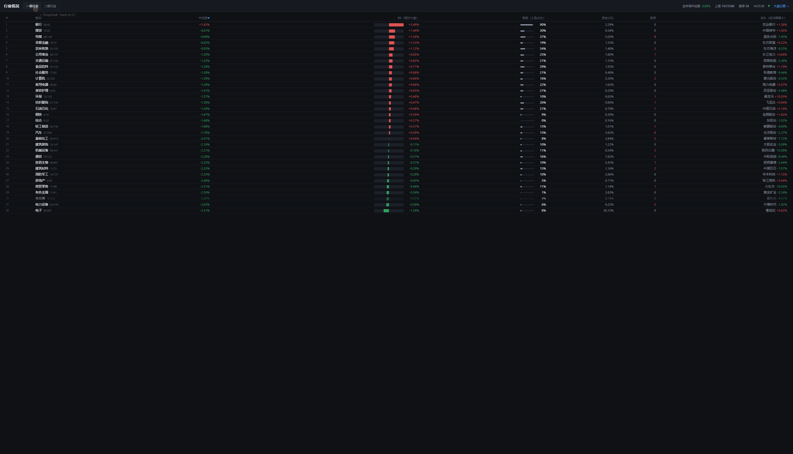

# 07 · 行业情况（板块强度）

> 云图的姊妹页。**云图是结构视图**（今天市场长什么样），
> **这页是强弱视图**（哪个板块真的在动、动到哪一步了）。
> 两者共用同一个后端进程和同一份行情快照，地址分别是 `/` 和 `/sector`。

---

## 一、为什么不能只看板块涨跌幅

板块涨跌幅是**结果**，它丢了三件事：

| 丢失的信息 | 后果 | 补它的指标 |
|---|---|---|
| 跑赢还是普涨 | 普涨日所有板块都红，看不出谁强 | **RS**（相对大盘） |
| 真动还是假动 | 板块 +2% 可能只是 1 只权重股拉的 | **宽度**（上涨家数占比） |
| 大票动还是小票动 | 「权重行情」和「普涨行情」该有完全不同的应对 | **spread** = 市值加权 − 中位数 |

还有一个比涨跌幅**更早**的指标：**资金占比**（该板块成交额 / 全市场成交额）。
涨跌幅是结果，资金占比是原因——产业级事件当天，相关板块的成交额占比会先跳，
价格随后才跟上。只盯涨跌幅，永远慢半拍。

---

## 二、指标定义

口径：`change_pct` 是**百分数**（`-2.61` 表示 -2.61%）；金额一律**元**。

| 字段 | 含义 | 怎么算 |
|---|---|---|
| `medianPct` | 板块涨跌幅**中位数** | 「典型个股」的涨跌。比加权平均更能代表板块——中石油涨 ≠ 石油产业涨 |
| `capwPct` | 市值加权涨跌幅 | 指数口径 |
| `spread` | `capwPct − medianPct` | 大于 0 是权重行情，贴近 0 是普涨 |
| `breadth` | 上涨家数 / 成分家数 | **一致性**。低于 70% 说明不是板块行情 |
| `rsMedian` | `medianPct` − 全市场中位数 | **排序主键**，回答「谁跑赢」 |
| `rsCapw` | `capwPct` − 全市场加权 | 指数口径的相对强度 |
| `amountShare` | 板块成交额 / 全市场成交额 | 钱在哪 |
| `limitUpCount` | 板块内涨停家数 | 情绪强度 |
| `upCount` / `downCount` / `flatCount` | 涨跌平家数 | 宽度的原始数据 |
| `leaderName` / `leaderPct` | 板块内**成交额最大**的那只票 | 「谁在动」的直接答案 |

---

## 三、为什么「产业」不等于「申万行业」

申万一/二级是 **31 / 131 个静态分类**。而「AI 算力」这个**产业**横跨：

`电子`（半导体·光学光电子·元件·消费电子）+ `通信`（通信设备）+
`计算机`（计算机设备·软件开发·IT服务）+ `电力设备`（电网设备）

—— 至少 4 个一级、9 个二级行业。所以：

- **申万做骨架**（云图用的就是它：单标签、稳定、铺得成树）；
- **产业风波要看「主题篮子」**（若干二级行业的并集）。主题篮子还没做，排在下一步。

---

## 四、接口

| 路径 | 说明 |
|---|---|
| `GET /api/sector/strength` | 板块强度全量 JSON：`{updatedAt, market, l1[], l2[]}` |
| `GET /sector` | 行业情况页面 |

`l1` / `l2` 按 `rsMedian` 从强到弱排好序；`market` 是全市场汇总（`amountShare` 恒为 1）。

指标**不额外取数**——和云图共用同一份合并行情，在云图刷新那一步顺手算出来。
所以两个页面看到的永远是同一时刻的数据。

---

## 五、落盘与基线

截面指标**不需要历史**，但下面这些需要：

- 5 日 / 20 日 RS（判断「到哪个阶段了」）
- 放量倍数（当日成交额 ÷ 过去 N 日均值）

所以每 **5 分钟**把一级行业快照追加到 `runtime/data/sector/snapshots.jsonl`
（`SNAPSHOT_INTERVAL_SEC = 300`）。不限流的话后台 5 秒一轮，一天能写几万条，
而且盘中没有额外信息量。

用 JSONL 而不是 Parquet：盘中追加写最合适，收盘后再压缩成日线。

---

## 六、前端

单文件 `web/sector/index.html`（内联 CSS/JS），刻意不拆成三份——这个页面只有一张表。

### 页面自带解释（不是只给数字）

光有一张数字表没用——不知道这几个数该按什么顺序看、什么算「好」。所以页面内置三层解释：

| 层 | 内容 |
|---|---|
| **结论条**（常驻） | 用数据生成一句人话：「全市场普跌（中位数 −2.00%，14% 的票在涨）。32 个行业里 20 个跑赢大盘，最强 银行（RS +3.52%、宽度 95%）。资金最集中：电子 26.0%。」 |
| **「怎么看这一页」**（默认展开，可收起） | 四步读法（RS → 宽度 → 资金占比 → 龙头）+ 两个口径提醒 |
| **表头副标题 + hover 提示** | 每列下面一行小字（谁跑赢 / 涨家数占比 / 钱在哪…），鼠标悬停有完整一句话 |

结论条会跟着层级切换重算——切到二级行业，它说的是二级行业的事。

### 交互

| 交互 | 说明 |
|---|---|
| 一级行业 / 二级行业 | 切换层级（结论条同步重算） |
| 点表头 | 按该列排序，再点一次反向 |
| 自动刷新 | 行情每 5 秒拉一轮；**时钟每秒自己走**，不依赖取数 |
| 顶部「大盘云图 →」 | 跳回结构视图 |

### 为什么需要「休市」标识

收盘后腾讯接口返回的是当天最后一口数据，**数字不会再动**。
不加标识的话，用户会以为页面卡死了——这正是第一版被反馈「没有实时刷新」的原因。
现在右上角会亮出「休市 · 收盘快照」（交易时段内则是绿点脉动 +「盘中 · 每 5 秒刷新」）。

交易时段判断只看**星期 + 钟点**（9:30–11:30 / 13:00–15:00），**不判断节假日**，
所以节假日会显示成盘中。这一点写在页面的帮助里，不藏着。

---

## 七、已知限制

1. **没有时序列**：5 日 / 20 日 RS、放量倍数都要等基线攒够。现在只有截面。
2. **没有主题篮子**：产业级视角（跨申万行业的链条）还没做。
3. **没有 RRG 四象限**：判断「启动 / 加速 / 衰竭 / 落后」需要 RS 的动量，依赖历史。
4. **未分类**：申万不覆盖北交所、次新股，约 358 只挂在「未分类」下。
   它**保留在列表里**——丢掉会让板块家数之和对不上大盘。
